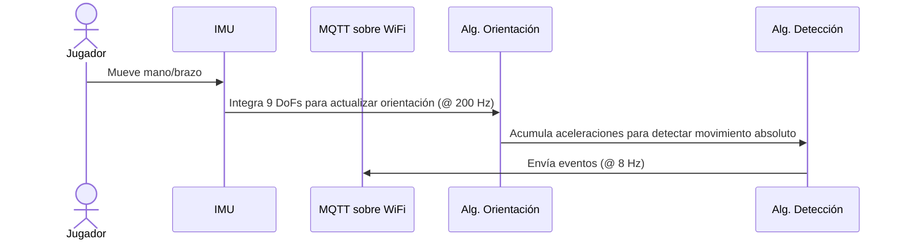
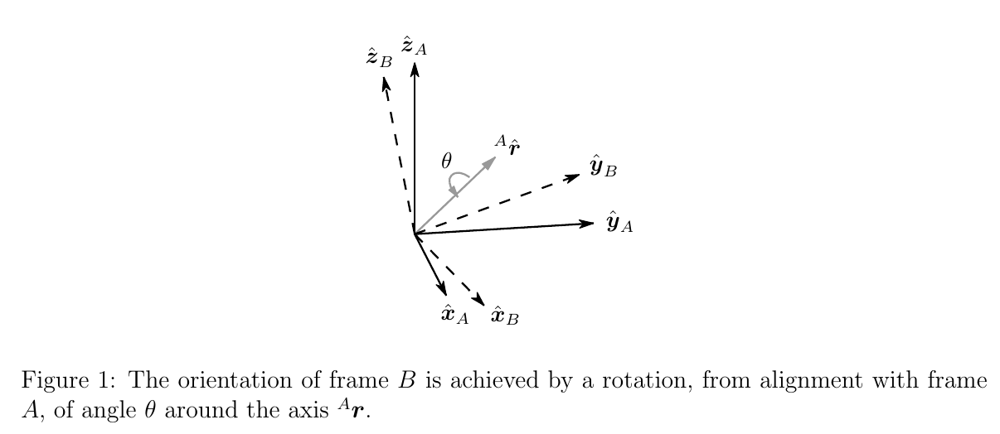

# Aether

Es una caja experiencial maker diseñada para explorar y reflexionar sobre la sincronización entre dos personas. Esta experiencia interactiva, alojada en una caja hexagonal de madera, permite a dos participantes a la vez descubrir las complejidades de sus movimientos coordinados y finalizar con un juego libre que concluye con un poema inspirador sobre la conexión humana.

La caja, con dimensiones de 40 cm por lado y 81 cm de alto, incorpora una pulsera para cada participante que rastrea sus movimientos. A través de la interacción, los participantes generan una respuesta única dentro de la caja, promoviendo la reflexión sobre la sincronización y la conexión interpersonal.

Presentación del proyecto:
[Aether.pdf](https://github.com/user-attachments/files/20062971/Aether.pdf)

# Código y desarrollo del proyecto

[Brain (unity project)](https://github.com/MakersPlusBCN/aether-brain)

[Pulseras](https://github.com/MakersPlusBCN/aether-wristband)

[Orchestrates services within the central PC](https://github.com/MakersPlusBCN/aether-orchestrator)

# Lógica de las pulseras

Una descripción a alto nivel de los procesos que ocurren en la CPU

## Sobre el algoritmo de orientación

El algoritmo, basado en las mediciones tomadas por la IMU a 200 muestras por segundo, resuelve el problema de mantener correctamente actualizada la orientación "absoluta" de la pulsera (es decir, en el marco de referencia de la Tierra "fija"), a partir de las mediciones de las aceleraciones lineales y angulares y el campo magnético de la Tierra, referidas al marco de referencia local de la IMU. Como se ve en el siguiente diagrama, tomado del [reporte del algoritmo](https://github.com/madison-embedded/documentation/blob/master/madgwick_internal_report.pdf):

Una buena ilustración del algoritmo de orientación, el cual hace parte de la funcionalidad crítica de las pulseras, puede verse en [este video](https://www.youtube.com/watch?v=BXsGWoOMtmU) por el autor del algoritmo original.

